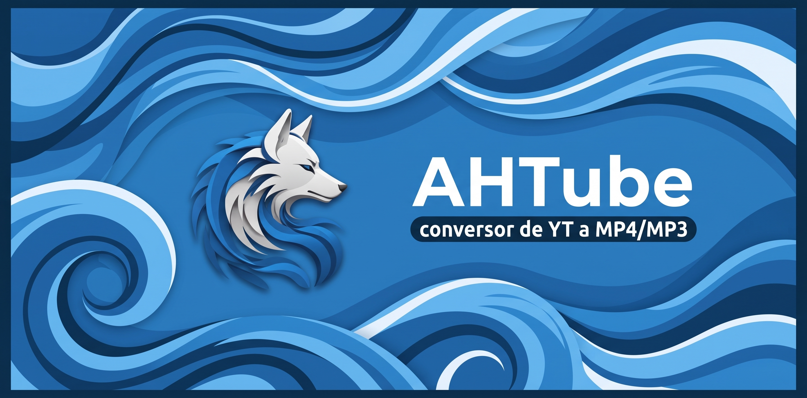
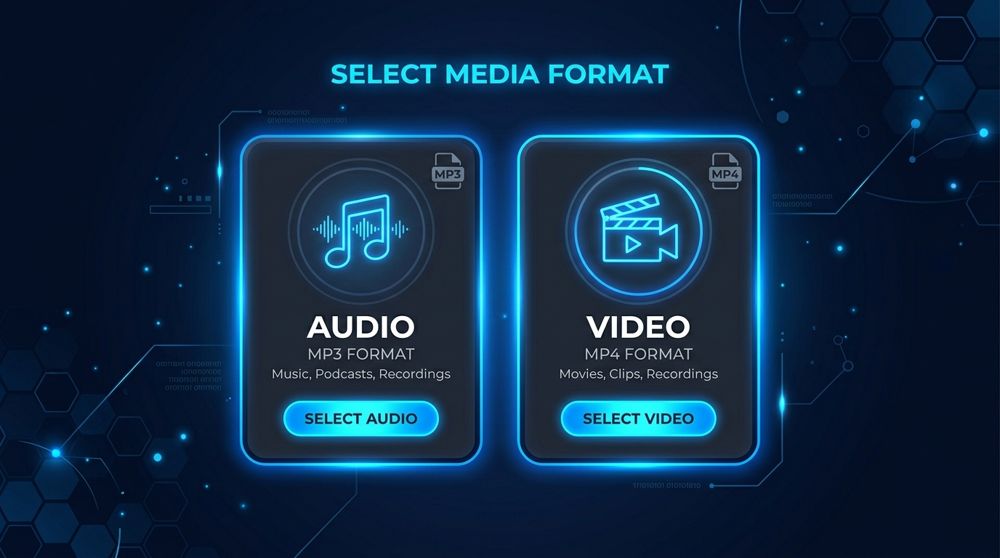
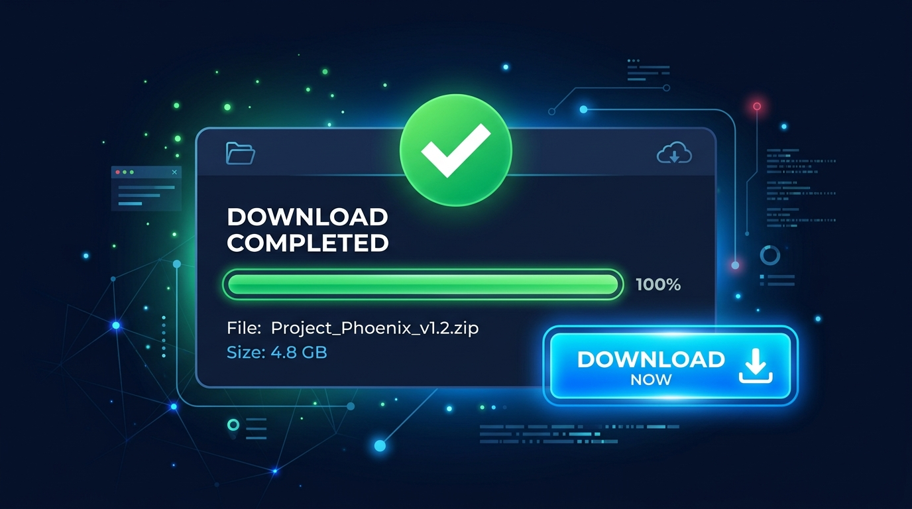

# AHTube 🎵🎥

> **¿Cansado de encontrar convertidores de YT a MP3 o MP4 que te limitan su uso o te llenan de redirecciones a sitios desconocidos?**  
> ¡Aquí tenés la solución! Ejecutá **AHTube** localmente en tu dispositivo y mantené el control total sin publicidad, sin límites y con máxima privacidad.



---

## 📌 Descripción del Proyecto

**AHTube** es una solución profesional desarrollada en Python que combina una **Interfaz Web (Streamlit)** moderna y una **Consola interactiva (CLI)** de alta velocidad. Permite:
- **Descarga Multimedia**: Analizar enlaces de YouTube, mostrar vista previa en tiempo real y extraer contenido en **Audio (MP3, WAV, M4A)** o **Video (MP4)** con calidad configurable.
- **Conversor de Imágenes**: Convertir imágenes individuales o por lotes entre formatos populares (**HEIC**, **JFIF**, PNG, JPG/JPEG, WEBP, ICO, BMP, TIFF, PDF) 100% en local y sin límites.
2. **🖼️ Conversor Profesional de Imágenes**: Un módulo independiente de procesamiento y conversión por lotes de imágenes (.webp, .png, .jpg, .ico, .bmp, .tiff, .pdf) con detección automática de formatos y manejo inteligente de transparencias. *(Ver [Guía Completa del Conversor de Imágenes](docs/IMAGE_CONVERTER.md))*.

---

## 🛠️ Tecnologías Utilizadas

- **Lenguaje**: [Python 3.10+](https://www.python.org/)
- **Interfaz Web**: [Streamlit](https://streamlit.io/) + [streamlit-option-menu](https://github.com/victoryhb/streamlit-option-menu)
- **Motor de Extracción**: [yt-dlp](https://github.com/yt-dlp/yt-dlp)
- **Procesamiento de Audio y Video**: [FFmpeg](https://ffmpeg.org/) / `static-ffmpeg`
- **Procesamiento y Conversión de Imágenes**: [Pillow (PIL)](https://python-pillow.org/)
- **Gestión de Entorno**: Python `venv`

---

## ⚙ Requisitos Mínimos para Desarrolladores

Antes de comenzar, asegurate de contar con:

1. **Python 3.10 o superior** instalado en el sistema.
2. **Pip** (gestor de paquetes de Python) actualizado.
3. **Acceso a Internet** para la conexión con la infraestructura de YouTube.
4. **Sistema Operativo**: Windows 10/11, macOS o Linux.

---

## 🚀 Instalación y Configuración

1. **Clonar o descargar el repositorio**:
   ```bash
   git clone https://github.com/tu-usuario/AHTube.git
   cd AHTube
   ```

2. **Crear y activar el entorno virtual**:
   - En **Windows (PowerShell)**:
     ```powershell
     python -m venv .venv
     .\.venv\Scripts\Activate.ps1
     ```
   - En **macOS / Linux**:
     ```bash
     python3 -m venv .venv
     source .venv/bin/activate
     ```

3. **Instalar dependencias**:
   ```bash
   pip install -r requirements.txt
   ```

---

## 💻 Modo de Uso

### 🌐 1. Interfaz Web (Streamlit) — Recomendado
Ejecutá el siguiente comando para iniciar la aplicación web interactiva en tu navegador:
```powershell
.\.venv\Scripts\python.exe -m streamlit run app.py
```

### ⚡ 2. Modo Consola (CLI)
Para ejecuciones ultrarrápidas sin interfaz gráfica:
- **Modo interactivo en consola**:
  ```powershell
  python main.py
  ```
- **Extracción directa por argumentos**:
  ```powershell
  python main.py "https://www.youtube.com/watch?v=VIDEO_ID" --mode audio
  python main.py "https://www.youtube.com/watch?v=VIDEO_ID" --mode video
  ```

---

## 📖 Guía Visual de Uso

### Paso 1: Copiar y pegar la URL de YouTube
Pegá el enlace en el campo principal. La aplicación analizará automáticamente el enlace y cargará una vista previa con los detalles del video.


### Paso 2: Seleccionar formato y calidad
Elegí entre extraer solo **Audio** (MP3 hasta 320 kbps, WAV o M4A) o el **Video completo** (MP4 en resolución hasta 1080p / Máxima calidad).



### Paso 3: Extraer y disfrutar
Hacé clic en **🚀 Iniciar Extracción**. Podrás ver el progreso en tiempo real y escuchar o reproducir el archivo directamente en la aplicación, o abrir la carpeta `downloads/` en primer plano.



---

## 📋 Alcances y Limitaciones

### ✅ Lo que SÍ se puede hacer
- **Uso Ilimitado y Local**: Sin límites de descargas ni conversiones, sin acortadores y sin publicidad molesta.
- **Extracción de YouTube**: Extracción en MP3 hasta **320 kbps** (Alta fidelidad), WAV, M4A o video MP4 en resolución máxima.
- **Conversión de Imágenes por Lotes**: Conversión individual y de carpetas completas entre formatos `.png`, `.jpg`, `.webp`, `.ico`, `.bmp`, `.tiff`, `.pdf`.
- **Manejo Inteligente de Transparencias**: Composición limpia de canal alfa para formatos que no admiten transparencia (evitando fondos negros).
- **Descarga Directa en ZIP y Explorador Local**: Descarga de lotes procesados en ZIP y apertura directa de las carpetas `downloads/` o `converted_images/` en primer plano.
- **Reproducción Integrada**: Escuchar audio y ver video descargado o previsualizar imágenes procesadas en la interfaz web.

### ❌ Lo que NO se puede hacer (Limitaciones Técnicas)
- **Contenido con Protección DRM**: No es posible descargar películas pagas, transmisiones en vivo protegidas o contenido privado de YouTube Primetime.
- **Bypass de Restricciones Geográficas Extremas**: Si un video está bloqueado en tu región por YouTube, la aplicación requerirá el uso de una VPN local en tu equipo.

---

## ⚖️ Responsabilidad y Términos de Uso (Legal Disclaimer)

> [!IMPORTANT]
> - **Uso Estrictamente Personal y Educativo**: **AHTube** ha sido creado exclusivamente con fines educativos, de demostración técnica y de respaldo personal de contenido propio o de libre distribución (dominio público).
> - **Exención Total de Responsabilidad del Autor**: El autor/desarrollador de este proyecto **NO se hace responsable** del uso indebido, malintencionado o ilegal que otros usuarios puedan darle a este software, ni de posibles violaciones a derechos de autor realizadas por terceros.
> - **Responsabilidad Exclusiva del Usuario**: Es responsabilidad única y exclusiva del usuario final asegurarse de que el uso de esta herramienta cumpla con los Términos de Servicio de YouTube y las leyes de propiedad intelectual vigentes en su respectivo país o jurisdicción.
