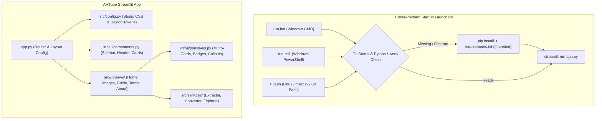

# Design: Studio Redesign, Multi-Platform Launchers, and Code Modularization

## Architecture Overview

## Design Decisions & Rationale

### 1. Token System & Design Hierarchy (Sky / Slate Studio)
- **Problem**: The current UI uses a generic blue theme with basic cards that feel templated.
- **Solution**: Implement the **Sky / Slate Studio** specification from `DESIGN_SYSTEM.md`:
  - Canvas: `#020617` (Deep Obsidian Slate 950).
  - Cards & Containers: `#0f172a` (Slate 900) with `#1e293b` borders and `0.75rem` (`12px`) border radius.
  - Primary Accent: `#38bdf8` (Electric Sky 400) for active buttons and interactive states.
  - Highlighting / Callouts: `#f59e0b` (Amber) for step callout boxes and alert banners.
  - Monospace Data: `JetBrains Mono` with `font-variant-numeric: tabular-nums` for all time, bitrate, dimension, and size metrics.
  - Typography Imports: `Inter`, `JetBrains Mono`, and `Material Symbols Rounded`.
- **Streamlit Alignment**:
  - Configure `.streamlit/config.toml` with `primaryColor = "#38bdf8"`, `backgroundColor = "#020617"`, `secondaryBackgroundColor = "#0f172a"`, and `textColor = "#f8fafc"`.
  - Use `src/config.py` for scoped CSS classes (`.dad-micro-card`, `.dad-badge`, `.dad-step-bar`, `.dad-callout`).

### 2. Multi-Platform Launcher Architecture
- **Problem**: Different users and operating systems require manual virtualenv setup, pip commands, and execution flags.
- **Solution**: Three standalone terminal scripts:
  1. `run.bat`: Windows Command Prompt launcher.
  2. `run.ps1`: Modern Windows PowerShell script with colored formatting and execution policy handling.
  3. `run.sh`: POSIX-compliant Bash shell script for Linux and macOS.
- **Flow**:
  1. Check git status: inform if working tree has unstaged or pending changes.
  2. Check Python interpreter: ensure Python >= 3.10 is installed and reachable.
  3. Check virtual environment: test for `.venv` folder; if absent, execute `python -m venv .venv`.
  4. Check dependencies: verify core dependencies or install `requirements.txt`.
  5. Launch Streamlit: run `.venv/bin/streamlit run app.py` (or Windows equivalent `.venv\Scripts\streamlit.exe run app.py`).

### 3. Modularization & <= 350 LOC Architecture Rule
- **Problem**: Large UI views and services can become unwieldy, violating clean architecture and cognitive simplicity.
- **Solution**:
  - Extract reusable studio UI elements into `src/ui/primitives.py` (micro-cards, badges, step bars, amber callouts).
  - Ensure every view and service file remains strictly `<= 350` lines.
  - Keep services dedicated to pure business logic without Streamlit dependencies.

## Security & Reliability Considerations

- Safe launcher execution: scripts will not blindly overwrite uncommitted git work or clobber existing environment variables.
- Clean path resolution: paths in scripts use script-relative directory anchors (`%~dp0` in bat, `$PSScriptRoot` in ps1, `$(cd "$(dirname "$0")" && pwd)` in sh).
